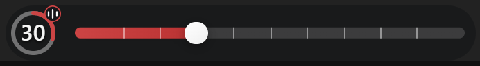
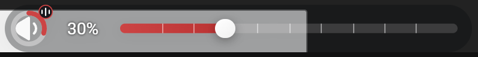
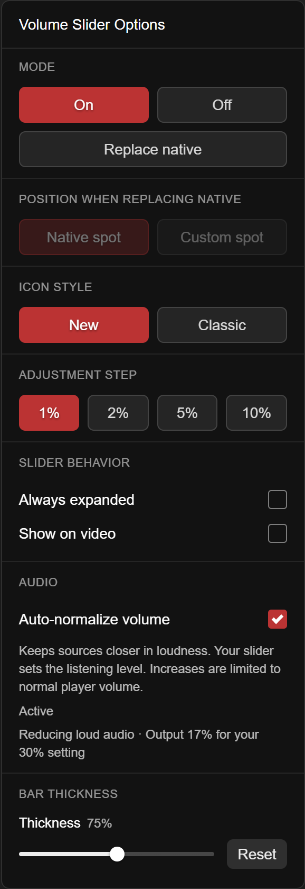
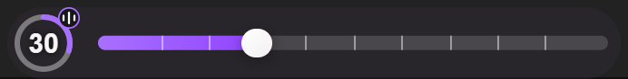
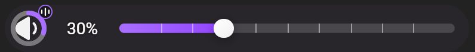
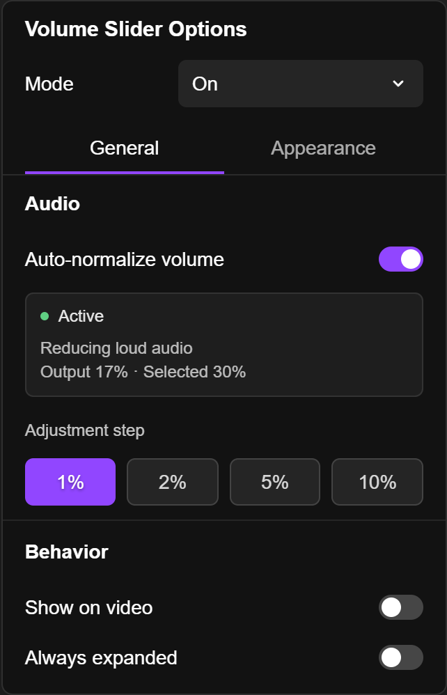
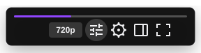
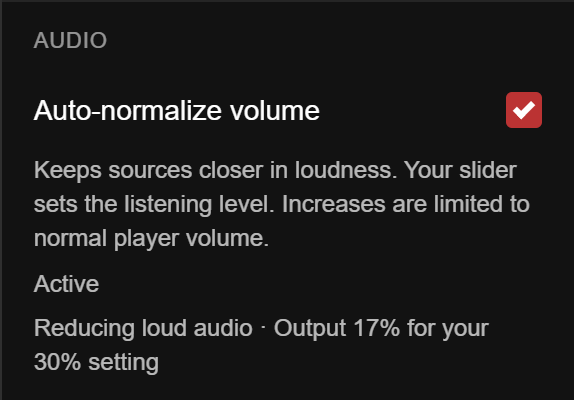
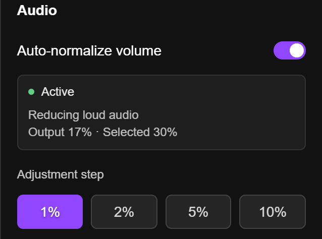

# YouTube and Twitch Volume Sliders

Compact, accessible volume controls for YouTube and Twitch, distributed as standalone userscripts for Tampermonkey and Violentmonkey.

Both scripts replace or complement the sites' native controls with a small indicator that expands into a full slider when needed. They share the same tested core while keeping site-specific behavior isolated.

## Preview

<details open>
<summary>YouTube theme</summary>

<table>
  <tr>
    <td align="center" valign="middle" width="58%">
      <strong>New</strong><br>
      <br><br>
      <strong>Classic</strong><br>
      
    </td>
    <td align="center" valign="middle" width="42%">
      <br>
      
    </td>
  </tr>
</table>
</details>

<details>
<summary>Twitch theme</summary>

<table>
  <tr>
    <td align="center" valign="middle" width="58%">
      <strong>New</strong><br>
      <br><br>
      <strong>Classic</strong><br>
      
    </td>
    <td align="center" valign="middle" width="42%">
      <br>
      
    </td>
  </tr>
</table>
</details>

The control and settings screenshots come from the built 2.9 scripts in local player fixtures, with normalization enabled. The feature is off by default. See [testing](docs/testing.md) to regenerate them.

## Install

### Requirements

- A modern browser
- A current userscript manager, such as [Tampermonkey](https://www.tampermonkey.net/) or [Violentmonkey](https://violentmonkey.github.io/)

### Version 2.9 preview

Version 2.9 introduces opt-in **Auto-normalize volume**. To test this branch, import [the YouTube userscript](dist/youtube-volume-slider.user.js) or [the Twitch userscript](dist/twitch-volume-slider.user.js) into your userscript manager, then reload the video page. See the [2.9 release notes](release-notes/2.9.md) for behavior and limitations. Version 2.9 is not yet published as a GitHub Release; the stable install links below remain on 2.8.3.

### GitHub Releases

Download: [GitHub Releases](https://github.com/Gimbuhh/YouTube-and-Twitch-Volume-Sliders/releases)

Latest published version, 2.8.3: [YouTube userscript](https://github.com/Gimbuhh/YouTube-and-Twitch-Volume-Sliders/releases/download/v2.8.3/YouTube.Volume.Slider.2.8.3.user.js) or [Twitch userscript](https://github.com/Gimbuhh/YouTube-and-Twitch-Volume-Sliders/releases/download/v2.8.3/Twitch.Volume.Slider.2.8.3.user.js). Approve the install prompt in your userscript manager, then reload the video page. The published 2.8.3 scripts do not include Auto-normalize volume.

### Tampermonkey Setup

1. Install [Tampermonkey](https://www.tampermonkey.net/) for your browser.
2. In Chrome, open `chrome://extensions`, select **Details** on Tampermonkey, and enable **Allow user scripts** if it appears.
3. Open the `.user.js` asset from the latest release and select **Install** when Tampermonkey prompts you.

## Features

- Compact control that expands to a full range slider
- Optional native-control replacement and persistent volume settings
- Opt-in loudness normalization for supported browsers and streams
- Configurable 1%, 2%, 5%, or 10% adjustment steps for dragging and scrolling
- Adaptive slider marks with easy-to-press 10% targets at fine adjustment steps
- Consistent 5% Arrow Up and Arrow Down volume changes
- Adjustable on-video slider size for larger remote-control displays
- Mute-safe restoration across reloads and single-page navigation
- Keyboard and screen-reader accessible mute and options controls
- Site-specific YouTube and Twitch adapters backed by shared UI and lifecycle code

## Volume adjustment

The **Adjustment step** option controls slider dragging and scrolling on the circular volume control. The selected value is saved separately for YouTube and Twitch.

Small trackpad movements accumulate before changing volume; normal mouse-wheel input keeps one selected step per event. Browser zoom gestures pass through the circular control without adjusting volume.

| Adjustment step | Slider marks |
| --- | --- |
| 1% | Taller marks every 10%; dragging remains precise to 1% |
| 2% | Marks every 2%, with taller marks every 10% |
| 5% | Marks every 5%, with taller marks every 10% |
| 10% | Taller marks every 10% |

With the 1% or 2% setting, pressing on or close to a taller mark selects that 10% value directly. Moving the grabber still uses the selected fine step. Arrow Up and Arrow Down remain fixed at 5% whenever the custom volume control handles them, independent of the adjustment-step setting.

## Loudness normalization (2.9)

Open **Volume Slider Options → Audio → Auto-normalize volume** to enable it. It starts off and is saved separately for YouTube and Twitch. The slider continues to set your preferred listening level; automatic corrections do not move it or replace the saved percentage.

The mode measures a local copy of the playing audio and adjusts the native player volume. It reacts quickly to loud passages, raises quieter sources gradually, ignores silence and very low background levels, and relearns after a source change. Quiet sources can use the full remaining range up to the player's normal 100% maximum. Channels are measured separately so stereo cancellation does not hide audible sound, while recent active audio keeps speech pauses and quiet word endings from driving increases. This is approximate RMS leveling, rather than broadcast-grade loudness matching or a peak limiter; the first moments of a new source can still differ in loudness.

The status below the toggle shows whether normalization is active, waiting, or unavailable. While active, it also shows whether audio is being raised or reduced and the adjusted output percentage alongside your selected percentage. Browser audio capture support and stream restrictions vary. If capture fails or becomes inaccessible, ordinary playback continues at your chosen volume. You may need to click the player to activate analysis after a reload. Turning normalization off, or setting the slider mode to **Off**, releases analysis and restores your chosen volume while preserving mute. The opt-in remains saved when slider mode is Off.

While normalization is on, a small, static waveform icon tucked into the volume ring's upper-right edge indicates that the option is enabled. It slightly overlaps the outer arc while leaving the volume number clear. Hover it for an explanation. It hides when normalization is off and keeps the control's original size and round background. The main number remains your chosen volume; current status and adjusted output remain available under Audio in Volume Slider Options.

<table>
  <tr>
    <td align="center"><strong>YouTube</strong><br></td>
    <td align="center"><strong>Twitch</strong><br></td>
  </tr>
</table>

**Active** means the audio capture is connected and being analyzed. Quiet passages and silence hold the current correction without making the status search for a source again.

Analysis stays on your device and uses only the playing media element. It does not request microphone access, record audio, send audio anywhere, or route a second copy to your speakers. For implementation and test details, see [normalization](docs/normalization.md).

## Development

npm is the repository's only supported package manager.

```sh
npm ci
npm run build
npm run check
npm run release -- 2.5
```

Edit canonical code under `src/`; never edit `dist/` or archives manually. `dist/` is generated, `archive/legacy/` preserves historical releases, and `archive/releases/` contains immutable packaged releases. See [architecture](docs/architecture.md), [testing](docs/testing.md), [releasing](docs/releasing.md), and [contributing](CONTRIBUTING.md).

The userscripts and this repository are made and maintained with Codex.

`node_modules/` is machine-local and intentionally excluded. Recreate it with `npm ci` and the frozen lockfile instead of copying it between Windows and macOS; npm installs native packages for the current machine.

## Releases

Every release contains the standalone `.user.js` files available for that version and matching release notes. The maintained history is recorded in the [changelog](CHANGELOG.md), and the evidence-based [version history](docs/version-history.md) covers original pre-project builds preserved under `archive/legacy/`.

Pull requests and pushes run the full check on Windows. A version tag such as `v2.5` runs the checks again and publishes both verified scripts as GitHub Release assets. See [releasing](docs/releasing.md) for the maintainer workflow.

## Contributing

Bug reports and focused pull requests are welcome. Read [CONTRIBUTING.md](CONTRIBUTING.md) before changing source or generated artifacts. Please report security concerns according to [SECURITY.md](SECURITY.md).

## Privacy

The userscripts make no network requests or telemetry calls. Settings remain in each site's `localStorage`.

If browser storage is unavailable, option changes and resets remain effective for the current page session but cannot be retained after reloading.

## Troubleshooting

Reload the video page after installation, confirm the userscript is enabled for the matching domain, and check that its mode is not set to Off. If site markup changes, run `npm run check` and report the affected site, browser, userscript manager, and page type.
