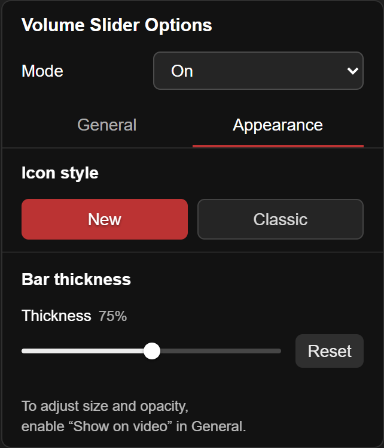
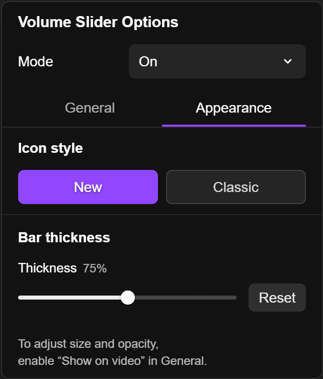

# YouTube and Twitch Volume Sliders

Compact, accessible volume controls for YouTube and Twitch, distributed as standalone userscripts for Tampermonkey and Violentmonkey.

Both scripts replace or complement the sites' native controls with a small indicator that expands into a full slider when needed. They share the same tested core while keeping site-specific behavior isolated.

## Preview

<details open>
<summary>YouTube theme</summary>

<table>
  <tr>
    <td align="center" valign="middle" width="58%">
      <strong>New</strong><br>
      <br><br>
      <strong>Classic</strong><br>
      
    </td>
    <td align="center" valign="middle" width="42%">
      <br>
      
    </td>
  </tr>
</table>
</details>

<details>
<summary>Twitch theme</summary>

<table>
  <tr>
    <td align="center" valign="middle" width="58%">
      <strong>New</strong><br>
      <br><br>
      <strong>Classic</strong><br>
      
    </td>
    <td align="center" valign="middle" width="42%">
      <br>
      
    </td>
  </tr>
</table>
</details>

The control and settings screenshots come from the built 3.0 scripts in local player fixtures, with normalization enabled. The feature is off by default. See [testing](docs/testing.md) to regenerate them.

## Install

### Requirements

- A modern browser
- A current userscript manager, such as [Tampermonkey](https://www.tampermonkey.net/) or [Violentmonkey](https://violentmonkey.github.io/)

### Version 3.0

Version 3.0 introduces opt-in **Auto-normalize volume**. Enable it in **Volume Slider Options → General → Audio**. See the [3.0 release notes](release-notes/3.0.md) for changes and limitations.

### GitHub Releases

Download: [GitHub Releases](https://github.com/Gimbuhh/YouTube-and-Twitch-Volume-Sliders/releases)

Install version **3.0**: [YouTube userscript](https://github.com/Gimbuhh/YouTube-and-Twitch-Volume-Sliders/releases/download/v3.0/YouTube.Volume.Slider.3.0.user.js) or [Twitch userscript](https://github.com/Gimbuhh/YouTube-and-Twitch-Volume-Sliders/releases/download/v3.0/Twitch.Volume.Slider.3.0.user.js). Approve the install prompt in your userscript manager, then reload the video page.

### Tampermonkey Setup

1. Install [Tampermonkey](https://www.tampermonkey.net/) for your browser.
2. In Chrome, open `chrome://extensions`, select **Details** on Tampermonkey, and enable **Allow user scripts** if it appears.
3. Open the `.user.js` asset from the latest release and select **Install** when Tampermonkey prompts you.

## Features

- Compact control that expands to a full range slider
- Optional native-control replacement and persistent volume settings
- Opt-in loudness normalization for supported browsers and streams
- Configurable 1%, 2%, 5%, or 10% adjustment steps for dragging and scrolling
- Adaptive slider marks with easy-to-press 10% targets at fine adjustment steps
- Consistent 5% Arrow Up and Arrow Down volume changes
- Adjustable on-video slider size for larger remote-control displays
- Mute-safe restoration across reloads and single-page navigation
- Keyboard and screen-reader accessible mute and options controls
- Site-specific YouTube and Twitch adapters backed by shared UI and lifecycle code

## Settings

Open **Volume Slider Options** beside the player’s native settings button. **Mode** stays above the tabs: choose On, Off, or Replace native. Replace native always uses the site's original volume position. Its arrow points up while choices are open and down when closed. **General** contains audio normalization, adjustment step, and behavior. **Appearance** contains icon style and bar thickness, plus size and opacity when **General → Show on video** is enabled.

Options opens with the menu focused. Press Tab to enter the first setting, or Shift+Tab to enter the last. With a tab focused, Left/Right Arrow switches tabs; Home/End selects the first/last tab. Tab moves through the visible controls, and Escape closes Options.

<table>
  <tr>
    <td align="center"><strong>YouTube · Appearance</strong><br></td>
    <td align="center"><strong>Twitch · Appearance</strong><br></td>
  </tr>
</table>

## Volume adjustment

The **Adjustment step** option controls slider dragging and scrolling on the circular volume control. The selected value is saved separately for YouTube and Twitch.

Small trackpad movements accumulate before changing volume; normal mouse-wheel input keeps one selected step per event. Browser zoom gestures pass through the circular control without adjusting volume.

| Adjustment step | Slider marks |
| --- | --- |
| 1% | Taller marks every 10%; dragging remains precise to 1% |
| 2% | Marks every 2%, with taller marks every 10% |
| 5% | Marks every 5%, with taller marks every 10% |
| 10% | Taller marks every 10% |

With the 1% or 2% setting, pressing on or close to a taller mark selects that 10% value directly. Moving the grabber still uses the selected fine step. Arrow Up and Arrow Down remain fixed at 5% whenever the custom volume control handles them, independent of the adjustment-step setting.

The Twitch script also runs a small keyboard relay in Twitch's official extension frames (`*.ext-twitch.tv`). This keeps Space and volume arrows working when an extension overlay has focus. Text fields, buttons, and keys handled by the extension keep their normal behavior; audio analysis runs only in the player page.

## Loudness normalization (3.0)

Open **Volume Slider Options → General → Audio → Auto-normalize volume** to enable it. It starts off and is saved separately for YouTube and Twitch. On later page loads, analysis can start from the playing video before the player controls finish loading. Startup audio comes in softly under protection as soon as samples arrive, then moves to the measured level; source restarts and switching YouTube videos on the same page use the same protection. The slider continues to set your preferred listening level; automatic corrections do not move it or replace the saved percentage.

Stream restarts keep that selected level. Player Up/Down keys change it in five-point steps, rather than stepping from the automatically adjusted output. Native volume controls can still change your listening level.

The mode uses LUFS-based analysis to match listening levels and processes the player's audio directly to reduce loud spikes before playback. Quieter sources rise gradually, silence and very low background levels are ignored, and volume recovers smoothly after brief loud sounds. Automatic boost is limited, so especially quiet recordings may remain below target. Stereo channels stay linked without cancelling each other's measurements.

Audio stays quiet until protection is ready on page loads and video changes. Normalization adds a small audio delay and cannot guarantee identical loudness for every recording. Browser activation and source restrictions still apply; if processing is unavailable, ordinary playback continues at your selected volume with a status warning. Normalization takes priority over Twitch's 7TV compressor when enabled; switching processors requires a reload. See [normalization](docs/normalization.md) for details and [testing](docs/testing.md#audio-normalization) for verification.

The status below the toggle shows whether normalization is active, waiting, or unavailable. While active, it also shows whether audio is being raised or reduced. **Output** is the volume currently applied to the player; **Selected** is your chosen slider percentage. Browser audio capture support and stream restrictions vary. If capture fails or becomes inaccessible, ordinary playback continues at your chosen volume. You may need to click the player to activate analysis after a reload. Turning normalization off, or setting the slider mode to **Off**, releases analysis and restores your chosen volume while preserving mute. The opt-in remains saved when slider mode is Off.

A small, static waveform icon tucked into the volume ring's upper-right edge shows normalization is on. It stays visible during normal startup, pause, buffering, mute, and zero volume. It hides if audio analysis is blocked or unavailable, or the option is off. It slightly overlaps the outer arc while leaving the volume number clear and keeps the control's original size and round background. The main number remains your chosen volume; current status and adjusted output are available under Audio in Volume Slider Options. Temporary audio access failures retry automatically.

<table>
  <tr>
    <td align="center"><strong>YouTube</strong><br></td>
    <td align="center"><strong>Twitch</strong><br></td>
  </tr>
</table>

**Active** means normalization is processing the audio. Quiet passages and silence keep the source connected.

Analysis stays on your device and uses only the playing media element. It does not request microphone access, record audio, send audio anywhere, or route a second copy to your speakers. For implementation and test details, see [normalization](docs/normalization.md).

## Development

npm is the repository's only supported package manager.

```sh
npm ci
npm run browsers:install
npm run check
npm run release -- 2.5
```

Edit canonical code under `src/`; never edit `dist/` or archives manually. `dist/` is generated, `archive/legacy/` preserves historical releases, and `archive/releases/` contains immutable packaged releases. See [architecture](docs/architecture.md), [testing](docs/testing.md), [releasing](docs/releasing.md), and [contributing](CONTRIBUTING.md).

Full verification requires Google Chrome, the isolated Firefox test build, and FFmpeg. `npm test` and `npm run check` include both browsers by default; use `npm run check:core` for a quick browser-independent development check.

The userscripts and this repository are made and maintained with Codex.

`node_modules/` is machine-local and intentionally excluded. Recreate it with `npm ci` and the frozen lockfile instead of copying it between Windows and macOS; npm installs native packages for the current machine.

## Releases

Every release contains the standalone `.user.js` files available for that version and matching release notes. The maintained history is recorded in the [changelog](CHANGELOG.md), and the evidence-based [version history](docs/version-history.md) covers original pre-project builds preserved under `archive/legacy/`.

Pull requests and pushes run the full check on Windows. A version tag such as `v2.5` runs the checks again and publishes both verified scripts as GitHub Release assets. See [releasing](docs/releasing.md) for the maintainer workflow.

## Contributing

Bug reports and focused pull requests are welcome. Read [CONTRIBUTING.md](CONTRIBUTING.md) before changing source or generated artifacts. Please report security concerns according to [SECURITY.md](SECURITY.md).

## Privacy

The userscripts make no network requests or telemetry calls. Settings remain in each site's `localStorage`.

If browser storage is unavailable, option changes and resets remain effective for the current page session but cannot be retained after reloading.

## Troubleshooting

Reload the video page after installation, confirm the userscript is enabled for the matching domain, and check that its mode is not set to Off. If site markup changes, run `npm run check` and report the affected site, browser, userscript manager, and page type.
